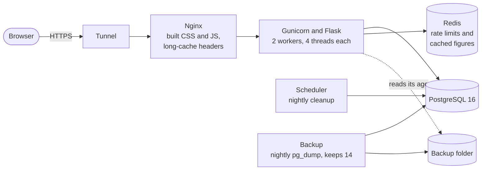
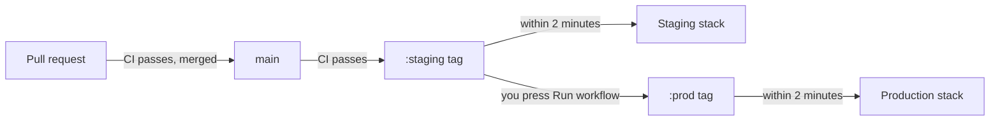

# SellTrack

Track what you sell, see what you make, and split the profit fairly.

**What's in it:** products and sales, a dashboard, a profit split between partners with settle-ups you can undo, in-app notifications, support messages and an admin console. It runs in Docker on a Raspberry Pi or a small server.

## Quick start

You need [uv](https://docs.astral.sh/uv/), Node 22+ and Docker.

```bash
make setup    # installs everything and builds the CSS and JavaScript
make test     # starts Postgres and Redis in Docker, then runs every test
docker compose up --build
```

Then open <http://localhost:8080> and register. To make yourself an admin, which opens the console at `/admin`:

```bash
docker compose run --rm web flask users create-admin
```

`make help` lists every command.

## How it fits together



Inside the app, routes in `app/blueprints/` stay thin, and the rules live in `app/services/`.

| Path | What it is |
|---|---|
| `app/services/` | The business rules: accounts, products, sales, reporting, the profit split, notifications, support, flags, the audit log and exports |
| `app/services/split_engine.py` | The split calculation itself, with no database or web code, so that every rule can be tested directly |
| `app/money.py` | Exact money in AUD: whole cents, strict parsing, and totals that never lose a cent |
| `app/models/`, `migrations/` | The database schema. See [`docs/schema.md`](docs/schema.md) |
| `app/blueprints/`, `app/forms/` | Routes and forms. See [`docs/endpoints.md`](docs/endpoints.md) |
| `app/security/` | Sessions, passwords (Argon2id), permissions, security headers and rate limits |
| `app/jobs/` | The nightly cleanup and its scheduler, and the steps a deploy runs |
| `app/figures_cache.py` | Dashboard totals in Redis, and how they stop being used as soon as they change |
| `app/templates/`, `app/static/src/` | The pages, styles and a small amount of JavaScript |
| `deploy/` | Nginx, Gunicorn, the production compose file, database roles, backups and the deploy script |
| `tests/` | Unit tests, integration tests on real Postgres and Redis, and browser tests |
| `docs/` | Guides for [users](docs/user-guide.md) and [admins](docs/admin-guide.md), and [runbooks](docs/runbooks/) |

## Working on it

```bash
make dev      # runs the app on http://localhost:5000, restarting when code changes
make assets   # in another terminal: rebuilds CSS and JavaScript as you save
make check    # style, types and known vulnerabilities
make test
```

`uv run pre-commit install` runs the quick checks before each commit.

### Tests

`make test` runs everything, and fails if coverage drops below 85% overall or 95% on the split engine.

- Integration tests use real Postgres and Redis, and fail rather than skip if either is down. To use your own instead of Docker, set `TEST_DATABASE_URL` and `TEST_REDIS_URL`, and run `make test-only`. The test database is wiped on every run, so they refuse to touch one whose name doesn't contain `test`.
- The tests of the database roles need a superuser connection, in `TEST_ADMIN_DATABASE_URL`. `make test` sets it, and without it they're skipped.
- Browser tests (`tests/e2e/`) run axe-core and keyboard checks on every page, in light and dark, at desktop width and at 360px. `make setup` installs Chromium, unless `E2E_CHROMIUM_PATH` points to one you already have. To skip them, use `uv run pytest -m "not e2e"`.

### Changing the database

Create a migration with `uv run flask db migrate -m "what changed"`, and read what it generated. **Each migration has to leave the schema working for the release before it**, because that's what lets a bad release roll back on its own. So add first, and only remove things in a later release, once nothing uses them.

### Keeping the numbers in step

The cleanup removes sales deleted over 30 days ago, sign-ins older than 90 days (apart from each account's latest 20) and read notifications older than 180 days. The privacy page promises this, and a test checks that the two agree.

Admin pages only show the audit details listed in `_VISIBLE_DETAILS` in `app/services/audit.py`. Audit entries must never hold customer names, names of people in a split or amounts, because the audit log outlives the account.

A bulk `update()` that changes dashboard figures, with no changed `Sale`, `UpfrontCost` or `Product` in the same transaction, needs `figures_cache.forget(user_id)`.

## Configuration

Every setting for running the app is explained in [`.env.example`](.env.example), and for a deployed stack in [`deploy/stack.env.example`](deploy/stack.env.example). Staging and production refuse to start without a strong secret key, a Postgres URL and debug off.

## Releasing and deploying



The server checks for new releases itself, so it needs no open ports and no CI credentials. Each deploy updates the database, restarts the stack and runs a smoke check, and goes back to the previous release by itself if that fails.

- [Installing on a Raspberry Pi or server](docs/runbooks/install.md)
- [Deploying and promoting](docs/runbooks/deploy.md)
- [Rolling back](docs/runbooks/rollback.md)
- [Restoring from a backup](docs/runbooks/restore.md)
- [When something's wrong](docs/runbooks/incident.md)
